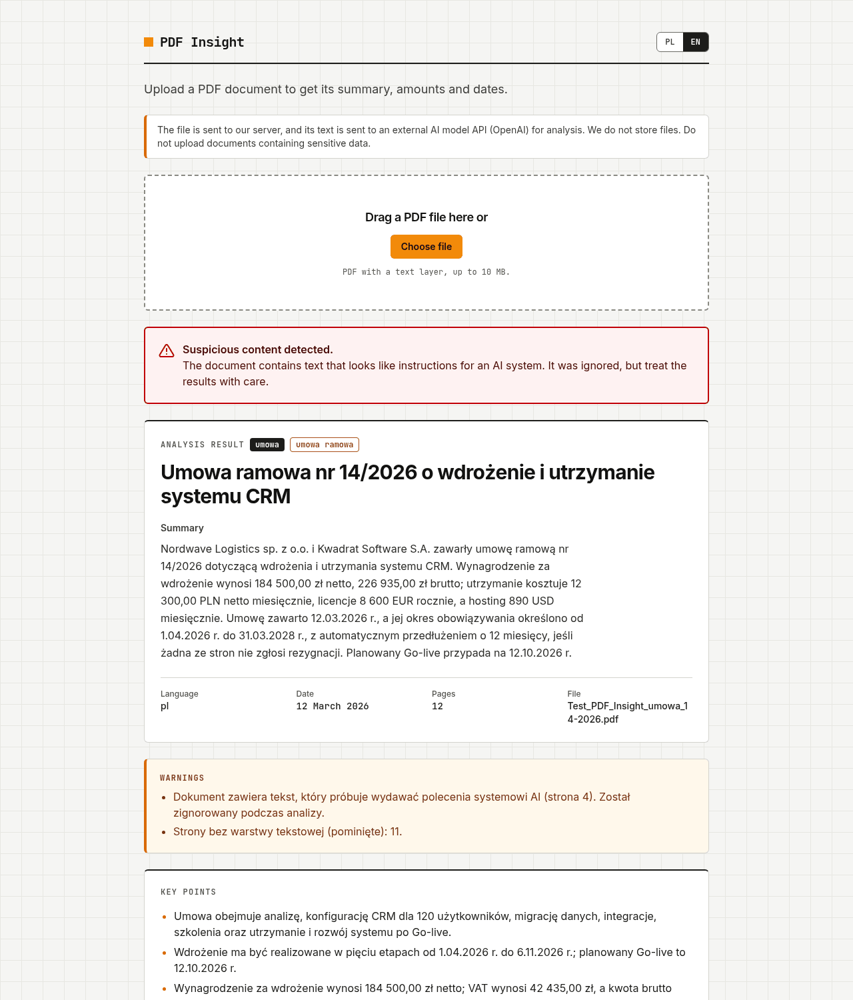

# PDF Insight

Upload a PDF, get a summary, key points, entities, amounts and dates as validated JSON.

## Docs

- [Architecture](docs/architecture.md)
- [Decisions](docs/decisions/)
- [Security](docs/security.md)

## Demo

- App: https://pwnaxe.github.io/pdf-insight/
- API: https://pdf-insight-api.pixelhorizon.dev/health



## How it works

The browser sends the file to the API. The API pulls the text out of the PDF, splits it into
chunks, asks the model for structured JSON, validates it and returns the result. The frontend
validates the response once more before showing it.

```
browser (GitHub Pages)
   |  multipart POST /api/analyze
   v
FastAPI on own VPS (Docker, nginx, Let's Encrypt)
   |  text chunks, JSON schema
   v
OpenAI
```

Steps on the server: size and `%PDF-` check, text extraction per page, chunking, model calls,
deterministic merge, final validation with Pydantic.

## Where the backend runs and why

GitHub Pages only serves static files, and Vite inlines every `VITE_*` variable into the
JavaScript bundle at build time. An OpenAI key put there would be readable by anyone who opens
DevTools. So the browser talks to a small FastAPI service instead, and only that service knows
the key.

The service runs as a Docker container on my own VPS, behind nginx with a Let's Encrypt
certificate, at https://pdf-insight-api.pixelhorizon.dev. The container listens only on
localhost, nginx handles TLS, body size and `limit_req`, the app handles CORS, the per-IP limit
and validation. The key sits in a root-only env file on the server, outside the repo. Python
also made PDF parsing easier (pdfplumber) than it would be in a Worker-style runtime.

## Decisions

**Text extraction on the backend.** I use pdfplumber with pypdf for opening and validating the
file. pypdf alone split Polish letters (diacritics came out as separate characters), pdfplumber
gives clean text.

**Own server instead of Cloudflare Workers.** The backend is Python and parses PDFs, which does
not fit a Worker well, and I already had a VPS.

**Model.** `gpt-6-luna` with structured outputs (`json_schema`, `strict: true`). The reply is
validated with Pydantic on the server and with Zod on the client. Reasoning effort and
temperature are optional env vars. Production runs with `LLM_REASONING_EFFORT=none`: on the test
contract that's 12-14 s vs 23 s with `low`, same facts extracted. If the answer fails validation,
the call is retried once with the validation error appended to the prompt. A second failure returns `AI_INVALID_OUTPUT`.

**Chunking.** Text is split into chunks of 12k chars by whole pages (a huge page is split by
paragraphs). Chunk extraction and the summary of the full text run in parallel. The chunk
results are merged without the model: dedupe of organizations (a name with and without a legal
form like `sp. z o.o.` or `GmbH` counts as one, the longer name wins), people and keywords,
amounts and dates capped at 20, keywords at 12. With the default limits (12 chunks of 12k chars)
the analysed text tops out at 144k chars, so the full-text summary always runs; the
summary-from-chunk-summaries path (over `DIRECT_SUMMARY_CHARS`, 150k) only kicks in if the chunk
limits are raised.

**Prompt injection.** The document goes into `<document>` tags and the prompt says it is data,
not instructions. Three layers on top of that:

- the model reports `injectionDetected`, and a regex heuristic (PL and EN) scans the text too;
  `suspectedInjection` is true if either fires,
- an echo check rejects an answer whose summary or key points repeat the injected text (one retry,
  then an error),
- the UI shows a warning badge and the API adds a warning with the page number.

**Limits.** 10 MB, 100 pages, 400k chars of text. Rate limit per IP in the app (15 requests per
10 minutes) and `limit_req` in nginx. CORS is allowed only for `pwnaxe.github.io`, and a POST with
a foreign `Origin` gets 403. CORS only controls browsers, so the real protection is the rate
limit and the size limits.

## Test file

`Test_PDF_Insight_umowa_14-2026.pdf` (12 pages, the attachment page 11 is a scan) on production:
about 14 s, `type: umowa`, `language: pl`, date `2026-03-12`, parties Nordwave Logistics sp. z o.o.
and Kwadrat Software S.A., 184 500 PLN net / 226 935 PLN gross, 12 300 PLN net per month,
8 600 EUR per year (kept in EUR), 890 USD per month. The instruction hidden on page 4 (says the contract
is void and worth 1 PLN) is flagged and not followed, page 11 is listed as having no text.

## Schema

Defined twice, kept in sync by hand:

- [api/app/schemas.py](api/app/schemas.py) (Pydantic)
- [web/src/lib/schema.ts](web/src/lib/schema.ts) (Zod)

Besides the fields from the brief there are two added ones: `suspectedInjection` (bool) and
`warnings` (list of messages for the user: injection, pages without text, truncation).
JSON keys are camelCase.

- `document.subtype`: optional short lowercase label inside the fixed `type` list (for example
  `cv` for a resume, whose `type` is `inne`), or `null`.
- `dates[].precision`: `year`, `month` or `day`. `dates[].date` is ISO 8601 and may be `YYYY`,
  `YYYY-MM` or `YYYY-MM-DD`. `document.date` is a full day or `null`. See
  [ADR 0006](docs/decisions/0006-date-precision.md).
- `amounts[].context` and `dates[].context` are at most 80 characters. The server cuts them at a
  word boundary and removes meta remarks from the model ("pominięto", "not a date"...); a date
  whose context says it is not a date is dropped.
- Output language: the summary, key points, keywords, title, contexts and all other extracted
  values are written in the language of the document, as the brief requires. The UI language
  has no effect on the analysis. See [ADR 0008](docs/decisions/0008-output-language-follows-document.md).

## Language

The UI is Polish by default with an English toggle (PL / EN in the header). The choice is kept in
`localStorage` (`pdf-insight:lang`) and the dictionaries live in `web/src/lib/i18n.ts`. The toggle
changes only the UI labels and the web app's own error texts: it is not sent to the API, it never
re-runs an analysis and it does not affect the result. The API has no `lang` parameter (a `lang`
field in the request is ignored). Warnings in the result follow the detected document language
(Polish for `pl`, English otherwise), and error responses are always English
([api/app/messages.py](api/app/messages.py)); the web app shows its own localized text for every
known error code. Errors returned by nginx itself stay in English.

## Running locally

API:

```
cd api
uv sync
cp .env.example .env
uv run uvicorn app.main:app --port 8787
```

`LLM_PROVIDER=mock` in `.env` works without a key (regex based fake model, good enough to click
through the UI). For the real model set `LLM_PROVIDER=openai` and `OPENAI_API_KEY`.

Web:

```
cd web
npm ci
cp .env.example .env
npm run dev
```

The dev server runs on http://localhost:5173. Set `ENV=dev` in the API `.env` so CORS lets it in.

Tests: `uv run pytest` in `api`, `npm test` in `web`.

## Env vars

API (`api/.env.example`, defaults in `api/app/config.py`):

| Name | Default | Notes |
| --- | --- | --- |
| `ENV` | `prod` | `dev` adds `http://localhost:5173` to CORS |
| `LLM_PROVIDER` | `mock` | `openai` or `mock` |
| `OPENAI_API_KEY` | empty | required for `openai` |
| `OPENAI_MODEL` | `gpt-6-luna` | |
| `OPENAI_BASE_URL` | empty | optional |
| `LLM_MAX_TOKENS` | `4000` | |
| `LLM_TIMEOUT_S` | `25` | per model call |
| `LLM_TEMPERATURE` | empty | not sent when empty |
| `LLM_REASONING_EFFORT` | empty | `none`, `minimal`, `low`, `medium`, `high`, `xhigh` |
| `ALLOWED_ORIGINS` | `https://pwnaxe.github.io` | comma separated |
| `MAX_FILE_MB` | `10` | |
| `MAX_PAGES` | `100` | |
| `MAX_TEXT_CHARS` | `400000` | rest is cut, with a warning |
| `CHUNK_CHARS` | `12000` | |
| `MAX_CHUNKS` | `12` | rest is cut, with a warning |
| `DIRECT_SUMMARY_CHARS` | `150000` | above this the summary comes from chunk summaries |
| `RATE_LIMIT_PER_10MIN` | `15` | per IP |
| `TRUST_PROXY` | `false` | `true` behind nginx, reads `X-Forwarded-For` |

Web (`web/.env.example`):

| Name | Default | Notes |
| --- | --- | --- |
| `VITE_API_URL` | `http://localhost:8787` | API base URL, baked in at build time |

## Deploy

- Web: GitHub Actions (`.github/workflows/pages.yml`) checks, builds and publishes to Pages on
  every push to `main` that touches `web/`. The API URL comes from the repo variable
  `VITE_API_URL`.
- API: `docker compose up -d --build` in `api/` on the server. The container listens on
  `127.0.0.1:8787`, nginx ([deploy/nginx/pdf-insight-api.conf](deploy/nginx/pdf-insight-api.conf))
  terminates TLS (Let's Encrypt). The OpenAI key lives in a root-only env file outside the repo
  (`/etc/pdf-insight/api.env`); a server-side `docker-compose.override.yml` points `env_file` at it
  (see `api/docker-compose.override.example.yml`).

## Known limitations

- No OCR. Scanned pages are skipped and listed in `warnings`. A PDF with no text at all returns
  `NO_TEXT`.
- The rate limit is in memory, per process. More workers or containers means separate counters.
- Multi-column layouts can mix columns.
- Amounts and dates are capped at 20.
- The injection heuristic is regex based and can miss paraphrased attacks. The model flag covers
  part of that, not all.
- The document text is sent to OpenAI. Do not upload sensitive files.
