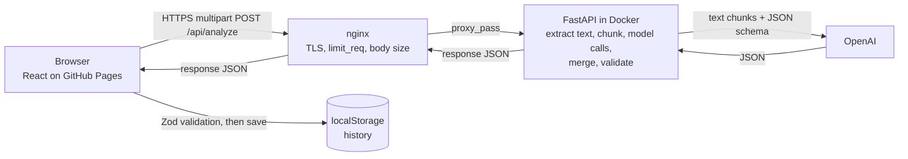
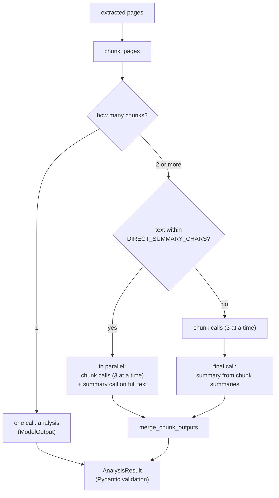

# Architecture

PDF Insight is a static React app plus a small FastAPI service. The browser uploads a PDF, the
API extracts the text, asks a model for structured JSON, validates it and sends it back. The app
validates it again before showing it.

## Request flow

The frontend lives in `web/src`: `api/client.ts` sends the request and validates the body with
`lib/schema.ts` (Zod), and `lib/history.ts` keeps the last 10 results in `localStorage`.

nginx (`deploy/nginx/pdf-insight-api.conf`) terminates TLS, applies `limit_req` and
`client_max_body_size`, and proxies to the container.

## Backend modules (`api/app`)

| Module | Role |
| --- | --- |
| `main.py` | Routes, CORS, Origin check, per-IP rate limit, upload size cap, error shape |
| `pdf.py` | Opens the file with pypdf, extracts text per page with pdfplumber |
| `chunking.py` | Splits pages into chunks of `CHUNK_CHARS`, capped at `MAX_CHUNKS` |
| `injection.py` | Regex heuristic for text that tries to instruct the model |
| `prompts.py` | System prompts and the `<document>` wrapping |
| `pipeline.py` | Model calls, retry, echo check, assembling the result |
| `merge.py` | Deterministic merge of chunk outputs (no model) |
| `llm/` | `LLMProvider` protocol, OpenAI provider, mock provider |
| `schemas.py` | Pydantic models for the model output and the response |
| `ratelimit.py` | In-memory sliding window per IP |
| `config.py` | Settings from env vars |

## Pipeline

`analyze_document` in `pipeline.py` picks one of three paths from the chunk plan.

- Single chunk: one call returns everything.
- Several chunks, text within `DIRECT_SUMMARY_CHARS`: chunk calls extract entities, amounts and
  dates, while a separate `summary` call reads the whole text. They run together.
- Several chunks, text over `DIRECT_SUMMARY_CHARS`: chunk calls first, then a `final` call that
  writes the summary from the chunk summaries and key points. With the default settings
  (12 chunks of 12k chars at most) this path is not reached; it applies if `MAX_CHUNKS` or
  `CHUNK_CHARS` are raised.

Every model call goes through `_call`, which validates the reply and retries once. See
[decisions](decisions/).
